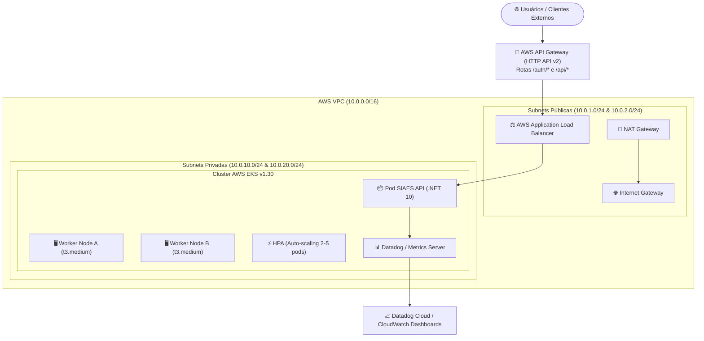

# FIAP Tech Challenge - Infraestrutura Kubernetes EKS & Networking (Fase 3)

[](https://github.com/dvdalves/FIAP.Tech.Challenge.Infra.Kubernetes/actions/workflows/ci-cd.yml)

Repositório responsável pelo provisionamento como código (**IaC - Terraform**) da **infraestrutura de rede (VPC)**, **Cluster Kubernetes Gerenciado (AWS EKS)**, **Managed Node Groups**, **AWS API Gateway** e **Stack de Observabilidade & Monitoramento**, conforme exigido na **Fase 3 do Tech Challenge SOAT - FIAP**.

---

## 🧭 Sumário

1. [Propósito do Repositório](#1-propósito-do-repositório)
2. [Tecnologias Utilizadas](#2-tecnologias-utilizadas)
3. [Arquitetura de Nuvem e Componentes](#3-arquitetura-de-nuvem-e-componentes)
4. [Recursos Provisionados](#4-recursos-provisionados)
   - [Rede & Conectividade (VPC)](#rede--conectividade-vpc)
   - [Cluster Kubernetes (AWS EKS)](#cluster-kubernetes-aws-eks)
   - [AWS API Gateway (HTTP API v2)](#aws-api-gateway-http-api-v2)
5. [Monitoramento e Observabilidade](#5-monitoramento-e-observabilidade)
   - [Métricas & Datadog Integration](#métricas--datadog-integration)
   - [Alarmes CloudWatch](#alarmes-cloudwatch)
   - [Horizontal Pod Autoscaler (HPA) & Metrics Server](#horizontal-pod-autoscaler-hpa--metrics-server)
6. [Passo a Passo de Provisionamento](#6-passo-a-passo-de-provisionamento)
   - [Pré-requisitos](#pré-requisitos)
   - [Execução via Terraform CLI](#execução-via-terraform-cli)
   - [Conexão ao Cluster com kubectl](#conexão-ao-cluster-com-kubectl)
7. [Esteira de CI/CD (GitHub Actions)](#7-esteira-de-cicd-github-actions)
8. [Tabela de Variáveis do Terraform](#8-tabela-de-variáveis-do-terraform)
9. [Segurança e Governança](#9-segurança-e-governança)

---

## 1. Propósito do Repositório

Isolar e automatizar o ciclo de vida da infraestrutura de orquestração de contêineres e comunicação do sistema **SIAES (Oficina Mecânica)**. Este repositório é responsável por garantir:

- Alta disponibilidade geográfica com subnets distribuídas em múltiplas Zonas de Disponibilidade (Multi-AZ).
- Isolamento estrito de segurança (nós de computação alocados em subnets privadas sem IP público).
- Escalabilidade horizontal e elástica de pods e nós baseada em métricas de CPU e memória.
- Roteamento centralizado, controle de tráfego, CORS e rastreabilidade via **AWS API Gateway**.
- Visibilidade operacional contínua através da integração nativa com ferramentas de observabilidade (**Datadog / CloudWatch / Prometheus**).

---

## 2. Tecnologias Utilizadas

| Tecnologia | Versão | Finalidade |
| :--- | :--- | :--- |
| **Terraform** | `>= 1.5.0` | Orquestração declarativa de infraestrutura como código (IaC) |
| **AWS EKS** | `1.30` | Orquestrador Kubernetes de nível corporativo gerenciado pela AWS |
| **AWS VPC & NAT Gateway** | Multi-AZ | Topologia de rede segura com subnets públicas e privadas |
| **AWS API Gateway** | HTTP API v2 | Ponto de entrada das requisições públicas, com throttling e logs |
| **Kubernetes Metrics Server** | `3.12.x` | Provedor de métricas de pods e nós para viabilizar autoscaling (HPA) |
| **Datadog Agent** | `3.66.x` | Agente DaemonSet para APM, traces distribuídos e logs estruturados |
| **AWS CloudWatch** | Nativo | Coleta de logs de auditoria do control plane e alarmes de SLA |
| **GitHub Actions** | v4 | Pipeline automatizada de validação sintática, linting e deploy |

---

## 3. Arquitetura de Nuvem e Componentes



---

## 4. Recursos Provisionados

### Rede & Conectividade (VPC)
- **VPC Dedicada**: Bloco CIDR `10.0.0.0/16` com suporte a nomes e resolução DNS internos.
- **Subnets Públicas (x2)**: Zonas `us-east-1a` e `us-east-1b` marcadas com as tags `kubernetes.io/role/elb = "1"` para alocação automática de Load Balancers públicos pelo AWS Load Balancer Controller.
- **Subnets Privadas (x2)**: Zonas `us-east-1a` e `us-east-1b` marcadas com `kubernetes.io/role/internal-elb = "1"` para instâncias EC2 dos worker nodes e banco de dados.
- **NAT Gateway & Elastic IP**: Posicionado na subnet pública, permitindo que os worker nodes baixem pacotes e contêineres sem ficarem expostos à Internet.

### Cluster Kubernetes (AWS EKS)
- **Control Plane**: Versão `1.30` com endpoints público e privado habilitados e logs ativos (`api`, `audit`, `authenticator`, `controllerManager`, `scheduler`).
- **Managed Node Group**:
  - Instâncias `t3.medium` baseadas em Amazon Linux 2023.
  - Alocação exclusivamente em subnets privadas.
  - Dimensionamento elástico: Mínimo 1, Desejado 2, Máximo 5 nós.
  - Atualização com política de tolerância de falhas (`max_unavailable = 1`).

### AWS API Gateway (HTTP API v2)
- Roteamento central com suporte nativo a CORS.
- Integração VPC Link para comunicação de baixa latência diretamente com a rede interna do EKS.
- Coleta de access logs em formato estruturado JSON enviada diretamente ao **CloudWatch Logs** com retenção de 14 dias.

---

## 5. Monitoramento e Observabilidade

Atendendo aos requisitos da **Fase 3**, a infraestrutura foi projetada para suportar observabilidade de ponta a ponta:

### Métricas & Datadog Integration
Ao definir `enable_datadog = true` e fornecer a `datadog_api_key`, o Terraform instala o **Datadog Agent** via Helm com:
- **APM & Tracing Distribuído**: Rastreabilidade de chamadas entre serviços e identificação de gargalos de latência.
- **Logs Estruturados (JSON)**: Ingestão contínua de logs contendo correlação de requisições (`traceparent`, `requestId`).
- **Métricas de Cluster**: Monitoramento de saturação de CPU, consumo de memória de nós e pods, e taxas de rede.
- **Dashboards Operacionais**:
  - Volume diário de ordens de serviço.
  - Tempo médio de execução por status (Diagnóstico, Execução, Finalização).
  - Taxa de erros 4xx e 5xx e falhas em integrações.

### Alarmes CloudWatch
São provisionados automaticamente alarmes para monitorar a saúde da infraestrutura:
- `api_gateway_high_latency`: Alerta se a latência média ultrapassar 2.000 ms.
- `api_gateway_5xx_errors`: Alerta se houver mais de 5 erros de servidor (HTTP 5XX) por minuto.

### Horizontal Pod Autoscaler (HPA) & Metrics Server
O repositório provisiona o **Kubernetes Metrics Server** (`kube-system`), permitindo que as regras de HPA declaradas nos manifests da aplicação executem o escalonamento horizontal automático baseado no consumo de CPU (> 70%) e memória (> 80%).

---

## 6. Passo a Passo de Provisionamento

### Pré-requisitos
- [Terraform CLI](https://developer.hashicorp.com/terraform/downloads) instalado (versão >= 1.5.0).
- [AWS CLI](https://aws.amazon.com/cli/) instalado e configurado com credenciais (`aws configure`).
- [kubectl](https://kubernetes.io/docs/tasks/tools/) instalado.

### Execução via Terraform CLI

```bash
# 1. Copiar variáveis de exemplo
cp terraform.tfvars.example terraform.tfvars

# 2. Ajustar terraform.tfvars com as configurações desejadas
# (ex: região, limites de autoscaling, credenciais do Datadog se aplicável)

# 3. Inicializar provedores e módulos
terraform init

# 4. Planejar as alterações
terraform plan -out=tfplan

# 5. Aplicar o provisionamento (criação da VPC, EKS e API Gateway)
terraform apply tfplan
```

### Conexão ao Cluster com kubectl

Após a conclusão do `terraform apply`, atualize o seu contexto local do `kubectl`:

```bash
aws eks update-kubeconfig --region us-east-1 --name oficina-eks-cluster

# Validar conexão com os nós
kubectl get nodes -o wide
```

---

## 7. Esteira de CI/CD (GitHub Actions)

A esteira declarada em [`.github/workflows/ci-cd.yml`](.github/workflows/ci-cd.yml) automatiza o controle de qualidade e a entrega contínua:

1. **`terraform-validate`**: Valida a formatação de código (`terraform fmt -check`), baixa provedores e valida a integridade lógica (`terraform validate`).
2. **`terraform-plan`**: Em Pull Requests, executa `terraform plan` e exibe o resumo dos recursos a serem modificados.
3. **`terraform-apply`**: Executado automaticamente após o merge na branch `main` ou `master`, aplicando as mudanças na AWS.

---

## 8. Tabela de Variáveis do Terraform

| Variável | Tipo | Padrão | Descrição |
| :--- | :--- | :--- | :--- |
| `aws_region` | `string` | `"us-east-1"` | Região AWS de provisionamento |
| `cluster_name` | `string` | `"oficina-eks-cluster"` | Nome do cluster EKS |
| `cluster_version` | `string` | `"1.30"` | Versão do Kubernetes |
| `vpc_cidr` | `string` | `"10.0.0.0/16"` | Bloco CIDR da VPC |
| `k8s_node_instance_types`| `list(string)`| `["t3.medium"]` | Tipos de instâncias EC2 do Node Group |
| `node_desired_size` | `number` | `2` | Capacidade desejada de nós |
| `node_min_size` | `number` | `1` | Limite inferior para auto-scaling |
| `node_max_size` | `number` | `5` | Limite superior para auto-scaling |
| `enable_datadog` | `bool` | `false` | Habilita instalação do Datadog Agent via Helm |
| `datadog_api_key` | `string` | `""` | Chave de API da organização Datadog |
| `enable_metrics_server` | `bool` | `true` | Instala Metrics Server para HPA |

---

## 9. Segurança e Governança

- **Branch Protection**: As branches `main` e `master` exigem revisão por Pull Request e aprovação obrigatória dos checks de validação do Terraform.
- **Menor Privilégio IAM**: Roles dedicadas com políticas gerenciadas estritas para o control plane e nós worker.
- **Acesso Docente**: O usuário `soat-architecture` possui permissão configurada para avaliação técnica.
